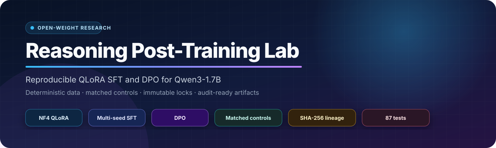
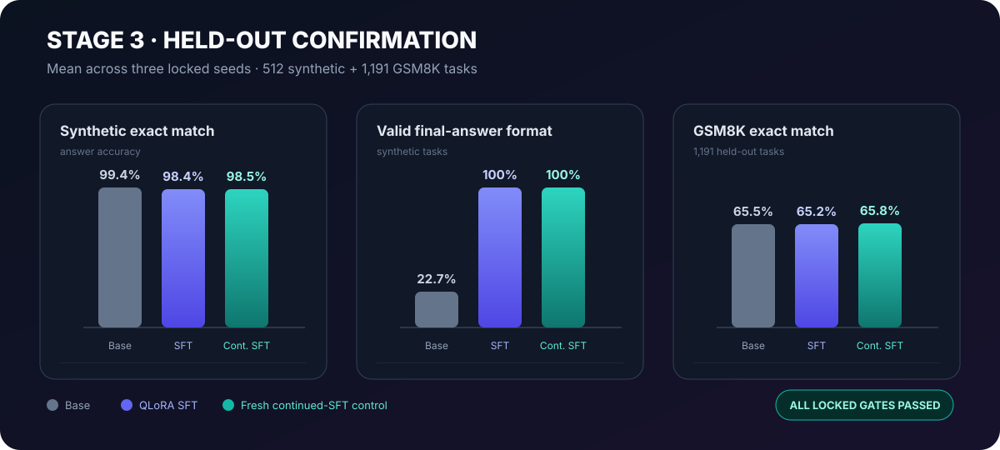
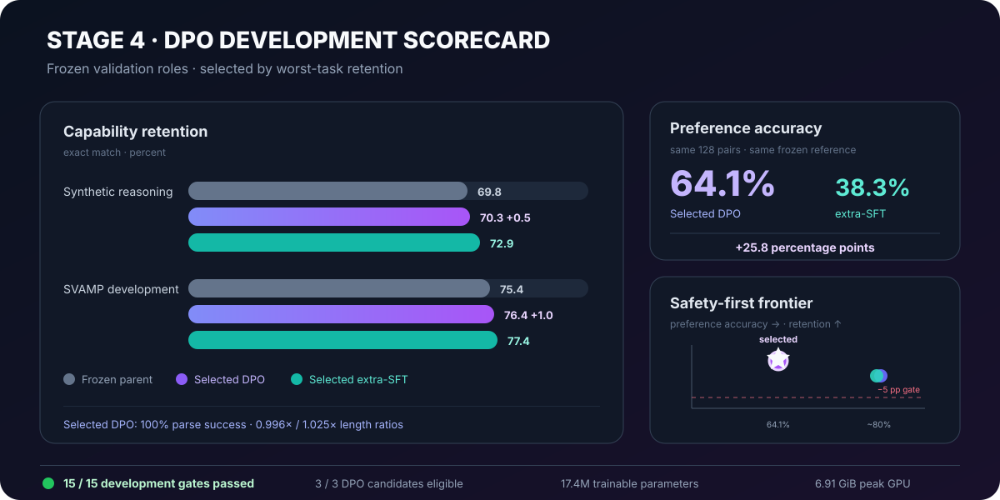
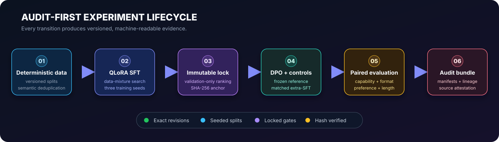

<div align="center">
  
</div>

<p align="center">
  <a href="README.ru.md">Русская версия</a>
</p>

<p align="center">
  <a href="https://github.com/RenataLi/open-weight-reasoning-lab/actions/workflows/core-tests.yml"></a>
  
  
  
  
  
  
</p>

# Reasoning Post-Training Lab

An audit-first, GPU-local research stack for **QLoRA supervised fine-tuning** and **Direct Preference Optimization** of [`Qwen/Qwen3-1.7B-Base`](https://huggingface.co/Qwen/Qwen3-1.7B-Base) across mathematical, logical, and structured reasoning.

The project treats post-training as a controlled experiment: deterministic data, exact model and dataset revisions, validation-only selection, immutable SHA-256 locks, matched extra-SFT controls, paired evaluation, and machine-readable evidence for every run.

## At a glance

| Research signal | Result |
|---|---:|
| Fresh Stage 3 held-out evaluation | **1,703 tasks** |
| Locked SFT training seeds | **3** |
| SFT synthetic final-answer format | **100.0%** |
| SFT synthetic exact match | **98.4% ± 0.3%** |
| Stage 4 DPO development gates | **15 / 15 passed** |
| Selected DPO preference accuracy | **64.1%** |
| Automated tests | **87 passed** |

## Verified outcomes

### Stage 3 — multi-seed held-out SFT confirmation

The locked recipe, `conditioned90_nll_lr5e5`, combines contract-conditioned prompts with 90% verified concise-reasoning targets. It was selected on development data, frozen behind an immutable lock, and then evaluated across seeds `101`, `202`, and `303` on **512 synthetic tasks + 1,191 GSM8K tasks**.

| Held-out metric | Base | QLoRA SFT, mean ± SD | Fresh continued-SFT, mean ± SD |
|---|---:|---:|---:|
| Synthetic exact match | 99.4% | **98.4% ± 0.3%** | **98.5% ± 0.1%** |
| Synthetic valid final-answer format | 22.7% | **100.0% ± 0.0%** | **100.0% ± 0.0%** |
| GSM8K exact match | 65.5% | **65.2% ± 0.0%** | **65.8% ± 0.6%** |
| GSM8K parse success | 100.0% | **100.0% ± 0.0%** | **100.0% ± 0.0%** |

<p align="center">
  
</p>

Every preregistered capability, format, uncertainty, and seed-stability gate passed. The independent integrity audit verified the selection/confirmation ordering, zero split overlap, adapter lineage, and artifact hashes.

### Stage 4 — safety-first DPO development search

Stage 4 compared three preregistered DPO variants with two fresh-state extra-SFT controls. All three DPO branches passed the full development gate set. The selector chose the low-learning-rate `dpo_sigmoid_lr2e6` branch by its strongest worst-task retention.

| Frozen development metric | Stage 3 parent | Selected DPO | Selected extra-SFT control |
|---|---:|---:|---:|
| Synthetic exact match | 69.8% | **70.3%** | 72.9% |
| Synthetic strict correct | 64.6% | **64.6%** | 71.4% |
| SVAMP exact match | 75.4% | **76.4%** | 77.4% |
| Chosen-over-rejected accuracy | — | **64.1%** | 38.3% |
| Parse success | 100.0% | **100.0%** | 100.0% |

The selected DPO policy improved exact match over its frozen parent on both reasoning suites while separating chosen from rejected responses by **+25.8 percentage points** over the selected extra-SFT comparator. Its generated-length ratios remained near the parent (`0.996×` synthetic and `1.025×` SVAMP), guarding against a length-only shortcut.

<p align="center">
  
</p>

See the [curated Stage 4 report](reports/stage4_development_search.md) and [machine-readable aggregate summary](reports/stage4_development_summary.json).

## Why this project stands out

- **Experiment integrity as code.** Search and confirmation are separate CLI phases; selection locks are immutable and confirmation exposure is single-use.
- **Cryptographic provenance.** Runs record resolved configs, exact revisions, file hashes, row-set hashes, source attestations, adapter lineage, and environment snapshots.
- **Matched controls.** DPO is compared with update-matched and token-proxy continued-SFT branches initialized from the same parent.
- **Capability-aware selection.** Ranking combines preference accuracy with exact-match retention, format validity, strict correctness, length ratios, and worst-family regressions.
- **Structured diagnostics.** Metrics are broken down by task family and difficulty, with paired transitions and bootstrap intervals where applicable.
- **Local efficiency.** NF4 QLoRA, bf16 compute, gradient checkpointing, LoRA adapters, and reference-log-probability precomputation keep the full workflow on a single GPU.

## Research workflow

<p align="center">
  
</p>

The reasoning benchmark spans seven families — arithmetic chains, exact division, linear equations, logic/code, percentage change, ratio allocation, and table aggregation — across mathematical, logical, and structured domains. Preference pairs contain deterministic, step-local corruptions with balanced higher/lower error directions and explicit semantic deduplication.

## Architecture

```text
src/reasoning_lab/
├── data/                    deterministic generators and dataset snapshots
├── training/                QLoRA SFT, continued-SFT, and DPO branches
├── evaluation/              generation, parsing, metrics, preference scoring
├── reporting/               Markdown and machine-readable reports
├── experiment_integrity.py  hashes, attestations, locks, exposure registry
├── stage*_selection.py      preregistered gates and ranking rules
├── stage*_pipeline.py       end-to-end orchestration
└── cli.py                   public command-line interface
```

## Quick start

### 1. Create the environment

```powershell
git clone https://github.com/RenataLi/open-weight-reasoning-lab.git
cd open-weight-reasoning-lab

py -3.12 -m venv .venv
.\.venv\Scripts\python.exe -m pip install -r requirements.lock.txt
.\.venv\Scripts\python.exe -m pip install -e . --no-deps
```

### 2. Validate the GPU stack

```powershell
reasoning-lab preflight
```

The preflight checks CUDA, bf16, bitsandbytes NF4 quantization, tokenizer loading, and a small forward pass before an experiment is allowed to train.

### 3. Run the compact end-to-end pipeline

```powershell
reasoning-lab generate-data --config configs/e2e_smoke.yaml
reasoning-lab run --config configs/e2e_smoke.yaml
```

### 4. Run the research stages

```powershell
# Controlled QLoRA pilot
reasoning-lab run-stage2 --config configs/stage2_qwen3_1_7b.yaml

# Validation-only multi-seed SFT search
reasoning-lab run-stage3-search `
  --config configs/stage3_reasoning_contract_qwen3_1_7b.yaml

# Development-only DPO + matched-control search
reasoning-lab run-stage4-search `
  --config configs/stage4_dpo_qwen3_1_7b.yaml
```

Later-stage configs intentionally bind to exact upstream run IDs and hashes. For a new lineage, reproduce the preceding stage and update those anchors before starting a new protocol version.

## Reproducibility contract

Each full run produces an audit-ready bundle containing:

- resolved configuration and config SHA-256;
- exact model/dataset revisions and deterministic seeds;
- environment and GPU preflight snapshots;
- trainable-parameter manifests and adapter hashes;
- data-file, row-ID-set, prompt-set, and semantic-set hashes;
- raw metrics by task family and difficulty;
- selection records, immutable lock anchors, and success/failure markers;
- source-code attestation and a manifest of primary artifacts.

Heavy local artifacts are intentionally excluded from Git: model caches, generated/external datasets, raw runs, adapters, checkpoints, predictions, logs, and sealed confirmation rows. The repository contains code, configs, tests, sanitized aggregate reports, and publication-ready figures.

## Tests

```powershell
.\.venv\Scripts\python.exe -m pytest
```

The full local suite currently contains **87 passing tests** covering config validation, deterministic generation, split integrity, parsing, metrics, checkpoint behavior, SFT/DPO lineage, selection gates, hash verification, and one-time confirmation semantics. GitHub Actions runs a lightweight CPU-only core subset on every push and pull request.

## Reports

- [Stage 1 pilot](reports/stage1_pilot.md)
- [Stage 2 controlled QLoRA pilot](reports/stage2_pilot.md)
- [Stage 3 multi-seed confirmation](reports/stage3_pilot.md)
- [Stage 3 machine-readable summary](reports/stage3_summary.json)
- [Stage 3 integrity audit](reports/stage3_integrity_audit.json)
- [Stage 4 DPO development search](reports/stage4_development_search.md)
- [Stage 4 aggregate summary](reports/stage4_development_summary.json)

## Research references

- [Direct Preference Optimization](https://arxiv.org/abs/2305.18290)
- [QLoRA](https://arxiv.org/abs/2305.14314)
- [Qwen3 Technical Report](https://arxiv.org/abs/2505.09388)
- [TRL DPOTrainer](https://huggingface.co/docs/trl/dpo_trainer)
- [PEFT quantization guide](https://huggingface.co/docs/peft/developer_guides/quantization)
- [GSM8K](https://arxiv.org/abs/2110.14168)
- [SVAMP](https://aclanthology.org/2021.naacl-main.168/)

## License

Apache License 2.0. See [LICENSE](LICENSE).

Citation metadata is available in [CITATION.cff](CITATION.cff).
